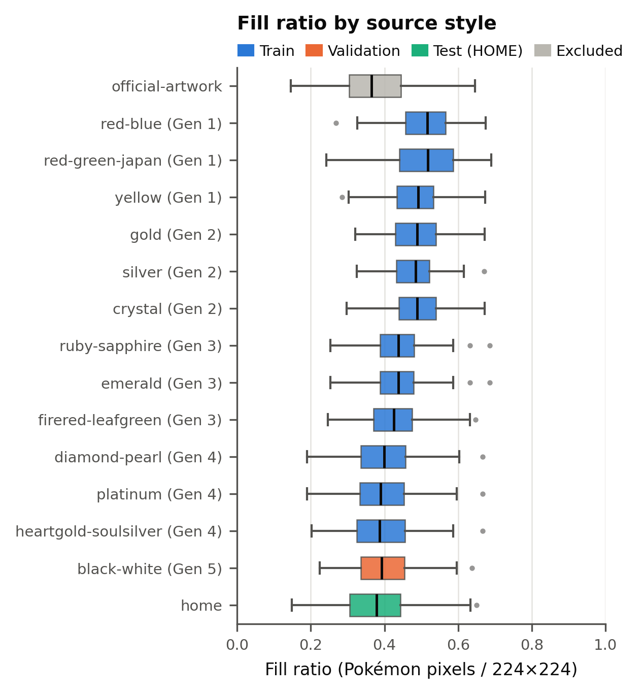
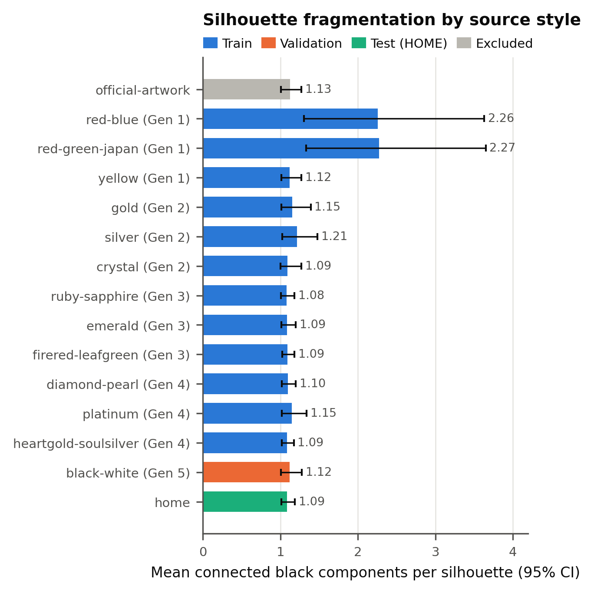

# DATA Folder Metadata

This file documents the data used in the "Who's That Pokémon?" project: where
it came from, how it was processed, how it is licensed, its known limitations,
and the meaning of every column in `manifest.csv`. It describes the **final
dataset** produced by `SCRIPTS/00_build_dataset.py`, which is the one every
analysis script uses.

**The Pokémon images themselves are not in this repository.** They are
copyrighted (see [License](#license)), so only the manifest (labels, splits,
and file paths) and the name/type lookup cache are committed. Anyone can
rebuild the identical images locally in a few minutes; see
[How to obtain the data](#how-to-obtain-the-data).

## Data Summary

The dataset contains **2,265 images** of the **151 Generation I Pokémon**
(Pokédex #1 Bulbasaur through #151 Mew), drawn from **15 art styles**: 13 main
series video games (Generations I–V), the *Pokémon HOME* 3D renders, and the
official artwork. Every style contributes exactly one front-facing,
default-form image of every Pokémon (151 images per style), so all 151 classes
are perfectly balanced.

Each image exists in two versions, which feed our two models:

- **Color**: the original sprite, cropped, padded to a square, resized to
  224×224, and composited onto a white background.
- **Silhouette**: the same image with every Pokémon pixel set to black (0) and
  the background to white (255). Only the outline shape is left; color,
  texture, and interior detail are removed.

The research question is whether a CNN can recognize Pokémon **from shape
alone** and how much accuracy is lost compared with color images. To test
generalization to a *new art style* rather than new pictures of a familiar
style, the data are split **by art style**, not at random:

| Split | Art styles | Images | Role |
|---|---|---:|---|
| Train | 12 game styles from Gen I–IV: red-blue, red-green-japan, yellow (Gen I); gold, silver, crystal (Gen II); ruby-sapphire, emerald, firered-leafgreen (Gen III); diamond-pearl, platinum, heartgold-soulsilver (Gen IV) | 1,812 | Model fitting |
| Validation | black-white (Gen V) | 151 | Learning rate, epochs, and Gen I inclusion |
| Test | home (*Pokémon HOME* 3D renders) | 151 | Final evaluation only (used once, in `04_evaluate.py`) |
| Excluded | official-artwork | 151 | Kept in the manifest for reference only |

Official artwork is excluded from every split because it is very close in
style to HOME, so putting it in training would leak the test style. In our CNN
experiments, `03_train_cnn.py --exclude-gen1` additionally drops the three Gen I
styles from training (leaving 1,359 training images) to test whether their
noisier silhouettes help or hurt; validation and test are unchanged.

## Provenance

- **Images**: the community-maintained **PokeAPI sprites repository**
  (<https://github.com/PokeAPI/sprites>), pinned to commit
  `1b3b7c0a538dd2226ae08d0d2f8955125075bbd4` (committed 2026-11-03) so that
  rebuilds are exact. We used one folder per game, front default sprite only.
  The default Gen I/II folders (red-blue, yellow, gold, silver, crystal) are
  opaque on a white background, so for those games we used each folder's
  `transparent/` copy. HOME images come from `sprites/pokemon/other/home` and
  official artwork from `sprites/pokemon/other/official-artwork`.
- **Names and primary types**: the **PokeAPI REST API**
  (<https://pokeapi.co/api/v2/pokemon/{id}>), queried once per Pokémon and
  cached in `pokeapi_cache.json`. The "primary type" is the type in slot 1.
  These are current PokeAPI typings (Generation VI onward), so for example
  Clefairy is listed as `fairy`, a type that did not exist in Generation I.

**Processing** (`SCRIPTS/00_build_dataset.py`), applied identically to every
image:

1. Crop to the bounding box of non-transparent pixels (alpha > 0). This
   removes the different amounts of empty space each game leaves around its
   sprites.
2. Center on a transparent square canvas with a 5% margin (padding rather
   than stretching keeps the aspect ratio, which matters for silhouettes).
3. Resize to 224×224 (ResNet-18's input size): nearest-neighbor for pixel
   sprites (longest side ≤ 128 px) so pixels stay crisp, area averaging (BOX)
   for large art (HOME, official artwork). BOX avoids the faint halo of
   partially transparent pixels that Lanczos resampling leaves around outlines,
   which would otherwise appear as noise in the silhouette.
4. **Color** = alpha-composite onto white. **Silhouette** = black wherever
   alpha > 0, white elsewhere.
5. Record labels, split, original size, and fill ratio in `manifest.csv`.

No images were dropped: all 2,265 source files had a usable alpha channel, and
no Pokémon is missing from any split.

## License

- **Our code and documentation** are released under the MIT License (see
  [`LICENSE.md`](../LICENSE.md)). This covers `manifest.csv` as a table of
  labels and paths and `pokeapi_cache.json` as factual name/type reference
  data.
- **The Pokémon images are not covered by our license and are not
  distributed here.** All Pokémon sprites, renders, and artwork are
  © The Pokémon Company / Nintendo / Creatures Inc. / GAME FREAK inc. The
  PokeAPI sprites repository is distributed under CC0 1.0 Universal, but its
  `LICENCE.txt` states that "All image contents within are Copyright The
  Pokémon Company"; CC0 covers the repository's organization, not the artwork. We download them locally only for non-commercial academic
  analysis, keep them out of version control (`DATA/images/` and `DATA/raw/`
  are in `.gitignore`), and do not commit any figure that displays them in
  color.
- PokeAPI data (names and types) are provided free of charge under PokeAPI's
  fair-use policy; our cache avoids repeated API calls.

## Ethical Statements

- **Copyrighted material.** The images are copyrighted works. To respect that,
  we do not redistribute them: the repository holds only labels, paths, and a
  script that fetches them from their public source. Figures showing color
  artwork (the EDA sample grid and color Grad-CAM maps) are generated locally
  and gitignored.
- **No personal data.** The dataset describes fictional creatures. There are
  no human subjects, personal information, or privacy concerns.
- **Fan-sourced data.** The sprites were ripped from the games and organized
  by volunteers. We pinned a specific commit and checked counts (151 per style,
  no missing files) but cannot independently verify every file against the
  original games.
- **Label choices.** Each image is labeled with a single species (Pokédex
  number). Default forms only: alternate forms, shiny variants, female
  variants, and back sprites are excluded, which keeps the label set clean but
  limits the conclusions to front-facing default poses.
- **Style-based split.** Splitting by art style is deliberately harder than a
  random split. Results measure transfer to an unseen style (HOME 3D renders)
  and should not be read as accuracy on any Pokémon image in general.
- **Silhouette quality varies by style.** Early Gen I sprites (red-blue,
  red-green-japan) have fragmented silhouettes: outline pixels detached from
  the body (see the second plot below). We report this instead of hand-editing
  sprites, and we test its effect with the `--exclude-gen1` experiment.

## Data Dictionary

`manifest.csv` has one row per image (2,265 rows).

| Column | Type | Description | Example | Uncertainty / Notes |
|---|---|---|---|---|
| `image_id` | string | Unique ID: `<source_style>_<3-digit Pokédex #>` | `red-blue_025` | — |
| `pokedex_id` | int (1–151) | National Pokédex number; **the class label** | `25` | — |
| `name` | string | PokeAPI species name (lowercase, hyphenated) | `pikachu` | Spelled the PokeAPI way, e.g. `nidoran-f`, `mr-mime` |
| `primary_type` | string | Slot-1 type from PokeAPI (15 values) | `electric` | Current typing, not original Gen I typing (e.g. `fairy`) |
| `source_style` | string | Game or art set the image comes from (15 values) | `red-blue` | One image per Pokémon per style |
| `generation` | int or empty | Game generation of the style (1–5) | `1` | Empty for `home` and `official-artwork` (not tied to one generation) |
| `split` | string | `train`, `val`, `test`, or `excluded` (determined by `source_style`) | `train` | See the split table above |
| `orig_width` | int (px) | Width of the original sprite before processing | `96` | Includes the original transparent margins |
| `orig_height` | int (px) | Height of the original sprite | `96` | Same as above |
| `fill_ratio` | float (0–1) | Share of the 224×224 processed image covered by the Pokémon (alpha > 0) | `0.4983` | Rounded to 4 decimals; depends on pose and body shape |
| `color_path` | string | Repo-relative path of the 224×224 color PNG | `DATA/images/color/train/025/red-blue_025.png` | File exists only after running `00_build_dataset.py` |
| `silhouette_path` | string | Repo-relative path of the 224×224 silhouette PNG (grayscale, 0/255) | `DATA/images/silhouette/train/025/red-blue_025.png` | Same as above |

`pokeapi_cache.json` maps each Pokédex number (string key `"1"`–`"151"`) to
`{"name": ..., "primary_type": ...}`. It is the source of the `name` and
`primary_type` columns.

**Original image sizes by style** (median width = height): official-artwork
475 px; red-blue and yellow 96 px; red-green-japan, gold, silver, crystal
56 px; ruby-sapphire, emerald, firered-leafgreen 64 px; diamond-pearl,
platinum, heartgold-soulsilver 80 px; black-white 96 px; HOME 512 px.

**Primary-type counts** (per style; ×15 for the whole manifest): water 28,
normal 22, poison 14, grass 12, fire 12, bug 12, electric 9, rock 9, ground 8,
psychic 8, fighting 7, ghost 3, dragon 3, fairy 2, ice 2.

## Explanatory Plots

Both plots below are summary statistics only; they contain no Pokémon
imagery. They are produced by `SCRIPTS/01_eda_figures.py` and stored in
`OUTPUT/figures/`.

**`eda_fill_ratio_by_style.png`**: how much of each 224×224 frame the Pokémon
covers, by art style and colored by split. Because every image is cropped to
its bounding box, scale differences between styles come only from body shape
and pose. Fill ratio is fairly consistent: Gen I–II sprites average about 0.48–0.51,
Gen III–V about 0.39–0.43, and the HOME test set 0.376. The HOME renders are
therefore close in object scale to the validation style (black-white, 0.398)
and the later training styles. That supports the comparison: test accuracy is not
inflated or deflated by HOME Pokémon being drawn much larger or smaller.



**`eda_silhouette_fragmentation_by_style.png`**: the mean number of connected
black regions per silhouette (8-connectivity), with 95% bootstrap CIs. A
clean silhouette is one region (the median is 1 for every style). The
original Game Boy sprites stand out: red-blue (2.26) and red-green-japan
(2.27) average more than twice as many fragments as every other style
(1.08–1.21), because their alpha masks leave detached outline and dither
pixels. The worst cases are red-blue Gastly (82 regions, a ball of scattered
gas pixels), Gloom and Haunter (32 each), and Koffing (12). Yellow's worst are
Koffing and Weezing (8 each, from their floating gas puffs). This is why we tested training without Gen I
(`--exclude-gen1`). The full table is in
`OUTPUT/tables/silhouette_quality_by_style.csv`.



## How to obtain the data

The images are not committed, so you need to rebuild them once. This took
28 seconds on our machine, mostly downloading, and can take a few minutes on a
slow connection.

```bash
# from the repository root, with requirements.txt installed
python SCRIPTS/00_build_dataset.py
```

The script:

1. Sparse-clones <https://github.com/PokeAPI/sprites> into `DATA/raw/pokeapi-sprites/`
   (blobless, only the 15 folders listed above, about 800 MB on disk) and checks out the
   pinned commit `1b3b7c0a538dd2226ae08d0d2f8955125075bbd4`. Requires `git`.
2. Reads names and types from `DATA/pokeapi_cache.json`. It calls the PokeAPI
   REST API only if an ID is missing, so with the committed cache it makes no API calls.
3. Writes 2,265 color PNGs to `DATA/images/color/<split>/<dex #>/` and 2,265
   silhouette PNGs to `DATA/images/silhouette/<split>/<dex #>/` (about 26 MB).
4. Rewrites `DATA/manifest.csv`.

**Check:** after it finishes, `git status` should show `DATA/manifest.csv`
**unchanged**. That confirms you have byte-identical labels, splits, and fill
ratios. The console should report `2265 rows`, `Dropped for no alpha channel: 0`,
and 1,812 / 151 / 151 / 151 images in train / val / test / excluded.
