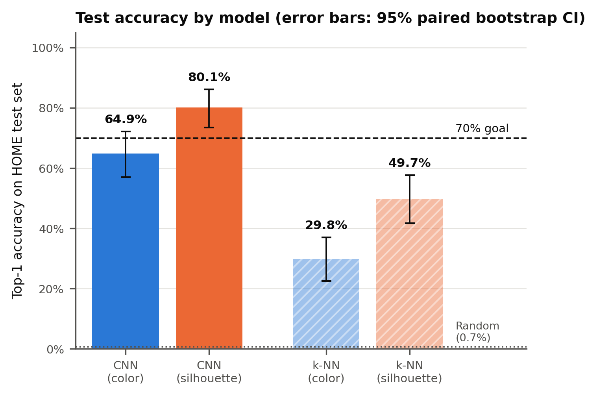
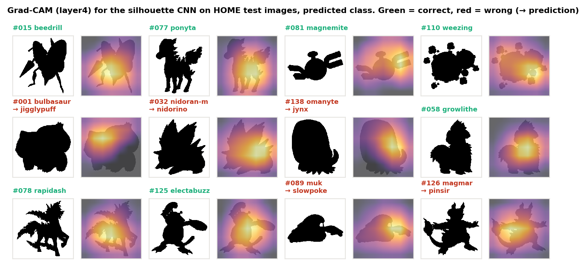
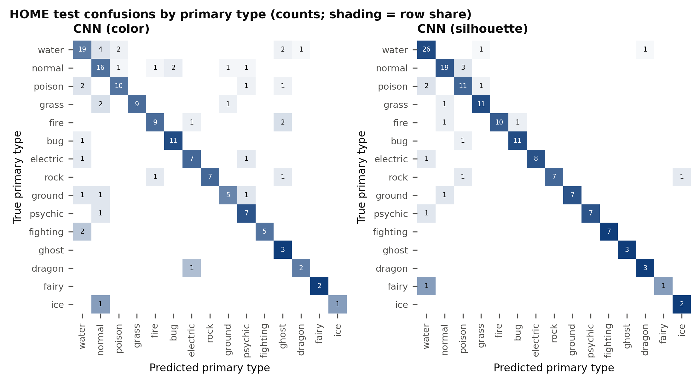

# Who's That Pokémon? Identifying Pokémon from Shape Versus Color

**Group:** The Good Guys  
**Group Members:** Brian Ryu, Keegan Jewell, Nathan Nguyen  
**Course:** DS 4002, University of Virginia  
**Project:** Project 3, MI3: Perform Analysis

## Project Overview

This project investigates how well a machine learning model can identify
Pokémon using different visual features, particularly shape and color. We
compare an image classifier trained on full-color sprites with the same
classifier trained on black silhouettes, which contain shape only, to learn
which visual characteristics contribute most to successful classification.

**Research question:** How does the use of shape versus color information
affect a machine learning model's ability to correctly identify Pokémon?
Concretely: can a convolutional neural network identify a Pokémon from its
black silhouette alone, the way viewers do in the anime's "Who's That
Pokémon?" segment, and how does its accuracy compare with the same network
trained on full-color images?

**Predefined success criterion (MI2):** the silhouette CNN reaches **at least 70%
top-1 accuracy** on a held-out art style (*Pokémon HOME* renders) **and** is
significantly better than a k-nearest-neighbor silhouette baseline (two-sided
exact McNemar test, p < 0.05).

## Contents of the Repository

This repository contains all code, metadata, and results needed to reproduce our
analysis of the 151 Generation I Pokémon. `SCRIPTS/` holds six numbered Python
scripts (plus a shared helper module and a `run_all.sh` driver). They rebuild
the image dataset from the public PokeAPI sprites repository, draw exploratory
figures, run a k-NN pixel baseline, fine-tune an ImageNet-pretrained ResNet-18
on color images and on silhouettes, evaluate all models on the test art style
with significance tests and bootstrap confidence intervals, and draw Grad-CAM
heatmaps. `DATA/` holds the image manifest (labels, splits, and paths) and its
metadata README. **The copyrighted Pokémon images themselves are not
committed**; `SCRIPTS/00_build_dataset.py` downloads and rebuilds them
identically. `OUTPUT/` holds every figure and table reported below.

## 1. Software and Platform

### Software

- **Python 3.13.7** for all data processing, modeling, and analysis
- **Bash** (`SCRIPTS/run_all.sh`) to run the whole pipeline in order
- **git** (any recent version), which `00_build_dataset.py` uses to download
  the sprites
- **GitHub** for version control and documentation

### Python packages

Exact versions are pinned in [`requirements.txt`](requirements.txt):

| Package | Version | Used for |
|---|---|---|
| `numpy` | 2.3.3 | Arrays, bootstrap resampling |
| `pandas` | 2.3.2 | Manifest and result tables |
| `pillow` | 12.0.0 | Reading, cropping, resizing images |
| `requests` | 2.32.5 | PokeAPI REST calls (only if the name/type cache is incomplete) |
| `scipy` | 1.16.3 | Connected-component analysis of silhouettes (EDA) |
| `scikit-learn` | 1.7.2 | `KNeighborsClassifier` baseline, macro F1 |
| `matplotlib` | 3.10.7 | All figures |
| `statsmodels` | 0.15.0 | Exact McNemar test |
| `torch` | 2.15.0 | CNN training and inference, Grad-CAM |
| `torchvision` | 0.29.2 | ResNet-18 + ImageNet weights, data augmentation |

### Platform

All results in this repository were produced on an **Apple MacBook Pro (M2 Max,
macOS 27.0.1)**. CNN training and inference ran on the **Apple-silicon GPU via
PyTorch's MPS backend**. The scripts pick the device automatically: an NVIDIA
GPU (CUDA) if present, else Apple MPS, else CPU. Each script prints the
device it uses, and `OUTPUT/tables/val_runs.csv` records it per run.

## 2. Map of Documentation

```text
pokemon-silhouette-classifier/
├── README.md                     <- this file: overview, setup, reproduction, results
├── LICENSE.md                    <- MIT license for our code (Pokémon images excluded)
├── requirements.txt              <- pinned Python package versions
├── .gitignore                    <- keeps copyrighted images, color figures, weights out of git
│
├── SCRIPTS/
│   ├── 00_build_dataset.py       <- downloads sprites (pinned commit), crops, makes silhouettes, writes manifest
│   ├── 01_eda_figures.py         <- exploratory figures + silhouette-quality table
│   ├── 02_knn_baseline.py        <- 1-NN raw-pixel baseline (color & silhouette), saves test predictions
│   ├── 03_train_cnn.py           <- fine-tunes ResNet-18; LR grid, early stopping, Gen I experiment, model selection
│   ├── 04_evaluate.py            <- the only test-set evaluation: metrics, McNemar, bootstrap, goal check, confusions
│   ├── 05_gradcam.py             <- Grad-CAM heatmaps for 12 test Pokémon, both CNNs
│   ├── cnn_utils.py              <- shared helpers for 03–05 (paths, seed, model, preprocessing); not run directly
│   └── run_all.sh                <- runs every step above in order and logs runtimes
│
├── DATA/
│   ├── README.md                 <- metadata: summary, provenance, license, ethics, data dictionary, plots, how to obtain
│   ├── manifest.csv              <- one row per image (2,265): label, type, style, split, size, fill ratio, paths
│   ├── pokeapi_cache.json        <- Pokédex # -> name and primary type (from the PokeAPI REST API)
│   ├── raw/                      <- [gitignored] sparse clone of PokeAPI/sprites, created by 00
│   └── images/                   <- [gitignored] 224×224 color/ and silhouette/ PNGs, created by 00
│
├── models/                       <- [gitignored] trained weights from 03 (12 runs + 2 selected *_best.pt)
│
└── OUTPUT/
    ├── run_all_log.txt           <- full console log of the reproduction run, with per-step times
    ├── figures/
    │   ├── eda_images_per_style.png             <- images per art style and per Pokémon
    │   ├── eda_fill_ratio_by_style.png          <- share of frame covered by the Pokémon, by style
    │   ├── eda_silhouette_fragmentation_by_style.png <- connected components per silhouette, by style
    │   ├── eda_sample_grid.png                  <- [gitignored, shows artwork] color/silhouette examples
    │   ├── analysis_plan_flowchart.png          <- MI2 analysis plan
    │   ├── accuracy_comparison.png              <- test top-1 per model, bootstrap CIs, 70% goal + random lines
    │   ├── confusion_matrix_cnn_pokedex.png     <- 151×151 test confusion matrices (both CNNs)
    │   ├── confusion_matrix_cnn_by_type.png     <- test confusions aggregated by primary type
    │   └── gradcam/
    │       ├── gradcam_grid_silhouette.png      <- Grad-CAM for 12 test Pokémon, silhouette CNN
    │       ├── silhouette/gradcam_silhouette_<dex>_<name>.png  <- one figure per Pokémon
    │       ├── gradcam_grid_color.png           <- [gitignored, shows artwork] same, color CNN
    │       └── color/gradcam_color_<dex>_<name>.png            <- [gitignored, shows artwork]
    └── tables/
        ├── silhouette_quality_by_style.csv      <- mean/median components and holes per style (01)
        ├── knn_test_predictions.csv             <- k-NN top-5 predictions on HOME (02)
        ├── val_runs.csv                         <- every training run's best val top-1/top-5/F1, epochs, runtime (03)
        ├── training_history.csv                 <- per-epoch train/val loss and accuracy for all runs (03)
        ├── selected_models.csv                  <- final LR and Gen I setting per mode, chosen on val (03)
        ├── results_summary.csv                  <- test top-1, top-5, macro F1, 95% CI for all 5 models (04)
        ├── mcnemar_tests.csv                    <- 2×2 counts, discordant pairs, exact p-values (04)
        ├── bootstrap_cis.csv                    <- 95% CIs for each top-1 and accuracy gaps (04)
        ├── goal_check.csv                       <- PASS/FAIL on the 70% finish line (04)
        ├── test_predictions.csv                 <- top-5 predictions + confidence, every model × test image (04)
        ├── confused_pairs_color.csv             <- top 15 confused Pokémon pairs, color CNN (04)
        ├── confused_pairs_silhouette.csv        <- top 15 confused Pokémon pairs, silhouette CNN (04)
        ├── confused_pairs_knn_color.csv         <- same for k-NN color (04)
        ├── confused_pairs_knn_silhouette.csv    <- same for k-NN silhouette (04)
        ├── disagreements_color_vs_silhouette.csv <- Pokémon only one CNN gets right (04)
        ├── accuracy_by_primary_type.csv         <- test top-1 by primary type, all models (04)
        └── gradcam_selection.csv                <- the 12 Grad-CAM Pokémon, predictions, CAM share on body (05)
```

## 3. Reproducing Our Results

These steps start from a fresh clone and reproduce every number and figure in
this repository. Every command is run **from the repository root** (the folder
that contains this README). Expected runtimes are from our M2 Max run.

### Step 1: Get the code

```bash
git clone https://github.com/ShiXzYz/pokemon-silhouette-classifier.git
cd pokemon-silhouette-classifier
```

(Or use GitHub's **Code → Download ZIP** and unzip it. You still need `git`
installed, because Step 3 uses it to download the sprites.)

### Step 2: Set up Python (≈3 min)

Install **Python 3.13.7** (from python.org, `pyenv`, or conda). Then create an
isolated environment and install the pinned packages:

```bash
python3.13 -m venv .venv
source .venv/bin/activate            # Windows: .venv\Scripts\activate
python -m pip install --upgrade pip
python -m pip install -r requirements.txt
```

Check that PyTorch sees your hardware:

```bash
python -c "import torch; print(torch.__version__, 'cuda', torch.cuda.is_available(), 'mps', torch.backends.mps.is_available())"
```

If both are `False`, everything still works on CPU, but Step 6 will take
roughly 1–2 hours instead of about 15 minutes. On an NVIDIA machine, you may need the CUDA
build of `torch==2.15.0` from <https://pytorch.org/get-started/locally/>.

**Option: run everything at once.** After this step you can run
`bash SCRIPTS/run_all.sh`, which does Steps 3–8 in order (14 min on our machine),
prints each step's runtime, and saves the full log to `OUTPUT/run_all_log.txt`.
Then skip to Step 9. Steps 3–8 below run the same commands one at a time and say
what each produces.

### Step 3: Build the dataset (≈30 s, needs internet)

```bash
python SCRIPTS/00_build_dataset.py
```

This downloads the Pokémon sprites from <https://github.com/PokeAPI/sprites>
(a blobless sparse clone of the 15 folders we use, pinned to commit
`1b3b7c0a`, ≈800 MB on disk in `DATA/raw/`; a slow connection can stretch this
step to a few minutes). It then crops, pads, and resizes
each image to 224×224, writes a color and a silhouette PNG for each to
`DATA/images/`, and rewrites `DATA/manifest.csv`.

**Expected:** the console reports `Wrote DATA/manifest.csv (2265 rows)`,
`Dropped for no alpha channel: 0`, and 1812 / 151 / 151 / 151 images for
train / val / test / excluded. `git status` must show **no change** to
`DATA/manifest.csv`, which confirms your images match ours exactly. Details are
in [`DATA/README.md`](DATA/README.md).

### Step 4: Exploratory figures (≈5 s)

```bash
python SCRIPTS/01_eda_figures.py
```

**Expected:** five PNGs in `OUTPUT/figures/` (`eda_*.png`,
`analysis_plan_flowchart.png`) and `OUTPUT/tables/silhouette_quality_by_style.csv`.
The console prints the silhouette fragmentation table (red-blue and
red-green-japan average ≈2.26–2.27 components; all other styles 1.08–1.21).

### Step 5: k-NN baseline (≈5 s)

```bash
python SCRIPTS/02_knn_baseline.py
```

Classifies each HOME test image by its single nearest training image
(Euclidean distance on 64×64 pixels). **Expected:** `k-NN (k=1) color top-1:
0.2980`, `silhouette top-1: 0.4967`, and `OUTPUT/tables/knn_test_predictions.csv`.
This is fully deterministic and should match to every digit.

### Step 6: Train the CNNs and select models on validation (≈14 min on GPU)

```bash
python SCRIPTS/03_train_cnn.py --mode color
python SCRIPTS/03_train_cnn.py --mode color --exclude-gen1
python SCRIPTS/03_train_cnn.py --mode silhouette
python SCRIPTS/03_train_cnn.py --mode silhouette --exclude-gen1
python SCRIPTS/03_train_cnn.py --select
```

Each of the first four commands (2–5 min each on our GPU) fine-tunes ImageNet-pretrained ResNet-18 at
three learning rates (1e-4, 3e-4, 1e-3), so there are 12 runs in total. Each
run uses early stopping on validation (Black/White) top-1 with patience 5 and
at most 30 epochs. `--exclude-gen1` removes the three Gen I styles from training.
All other settings are fixed and identical for both modes:

| Setting | Value |
|---|---|
| Model | torchvision ResNet-18, `IMAGENET1K_V1` weights, all layers fine-tuned, new 151-way output layer |
| Input | 224×224; silhouettes replicated from 1 to 3 channels; ImageNet mean/std normalization for both modes |
| Augmentation (training only) | random rotation ±15°, scale 90–110%, translation ≤5%, white fill; no flips, no color jitter |
| Optimizer | AdamW, weight decay 1e-4, batch size 32, cross-entropy loss |
| Seed | 4002 (Python, NumPy, PyTorch, data shuffling), re-set at the start of every run |

`--select` then picks the final models **using validation results only**.
First it chooses one learning rate shared by both modes (highest mean val
top-1 across that LR's four runs, so the final color and silhouette models
have identical hyperparameters). Then, for each mode at that LR, it keeps the
Gen I setting with the higher val top-1 (ties: macro F1, then val loss, then
keep Gen I). The test set is **never loaded** in this step.

**Expected:** 12 rows in `OUTPUT/tables/val_runs.csv`, per-epoch logs in
`training_history.csv`, the choice in `selected_models.csv`, and weights in
`models/` (gitignored, ≈45 MB each). Our per-run results are in
[Section 4](#4-results).

### Step 7: Evaluate on the test set (≈5 s)

```bash
python SCRIPTS/04_evaluate.py
```

This is the only script that scores models on the test set (HOME), and it runs
each final CNN once. It computes top-1, top-5, and macro F1 for all five models,
exact McNemar tests, paired-bootstrap CIs (10,000 resamples, seed 4002), the
finish-line check, and the confusion analysis. **Expected:** the console ends with
a `FINISH LINE` block and `RESULT: PASS` or `RESULT: FAIL`, and the tables and
figures listed in Section 2 are written.

### Step 8: Grad-CAM (≈5 s)

```bash
python SCRIPTS/05_gradcam.py
```

**Expected:** `OUTPUT/figures/gradcam/` with one grid per model plus 12
per-Pokémon figures per model, and `OUTPUT/tables/gradcam_selection.csv`.

### Step 9: Check that you got the same numbers

Compare your regenerated tables with the committed versions:

```bash
git status OUTPUT/ DATA/        # lists any file whose content changed
git diff --stat OUTPUT/tables/
```

- `DATA/manifest.csv`, `OUTPUT/tables/knn_test_predictions.csv`, and
  `silhouette_quality_by_style.csv` are deterministic and should be
  **byte-identical**.
- The CNN tables (`val_runs.csv`, `results_summary.csv`, `mcnemar_tests.csv`,
  `bootstrap_cis.csv`) should match ours exactly **on the same hardware
  backend**. We ran the full pipeline twice from scratch on MPS, and every
  table matched exactly apart from timing columns.
  On a different backend (CUDA or CPU) or a different PyTorch version, GPU
  floating-point differences can change a handful of predictions, so
  expect accuracies within a few test images (±1–2 percentage points) and the
  same qualitative conclusions. Compare against the table in Section 4. Small
  timing columns (`train_seconds`, `epoch_seconds`) always differ.
- Look at `OUTPUT/tables/goal_check.csv` for the PASS/FAIL verdict.

### Notes

- Figures that show Pokémon artwork in color (`eda_sample_grid.png`, the color
  Grad-CAM maps) are generated locally but **gitignored** because the images are
  copyrighted. Silhouette figures contain only black outlines and summary
  charts contain no imagery.
- `models/` is gitignored because the weights are too large for GitHub; Step 6
  recreates them.

## 4. Results

All numbers below come from the committed tables in `OUTPUT/tables/`, produced
by the clean `run_all.sh` run logged in `OUTPUT/run_all_log.txt` (14 min on
MPS).

### Model selection on validation (Black/White)

| Mode | Gen I in training | LR 1e-4 | LR 3e-4 | LR 1e-3 |
|---|---|---:|---:|---:|
| Color | with | 100.0% | **100.0%** (loss 0.042) | 98.7% |
| Color | without | 100.0% | 100.0% (loss 0.120) | 99.3% |
| Silhouette | with | 100.0% | **100.0%** (loss 0.061) | 98.0% |
| Silhouette | without | 99.3% | 100.0% (loss 0.069) | 98.7% |

Cells show val top-1 at each run's best epoch (`val_runs.csv`). The shared
learning rate is **3e-4**: it is the only LR where all four runs reached 100%.
At that LR, **both modes keep Gen I** in training. Because validation top-1
is saturated (100% with and without Gen I), the Gen I decision came down to
the val-loss tie-break: 0.042 vs 0.120 for color and 0.061 vs 0.069 for
silhouette. So validation could not separate the configurations on accuracy;
the Black/White style is evidently much closer to the training sprites than
HOME is. Training stopped after 8–15 epochs in every run.

### Test results (HOME, n = 151, one image per Pokémon)

| Model | Top-1 | 95% bootstrap CI | Top-5 | Macro F1 |
|---|---:|---:|---:|---:|
| **CNN (silhouette)** | **80.1%** (121/151) | 73.5–86.1% | 94.0% | 0.755 |
| CNN (color) | 64.9% (98/151) | 57.0–72.2% | 88.7% | 0.589 |
| k-NN (silhouette) | 49.7% (75/151) | 41.7–57.6% | 66.9% | 0.423 |
| k-NN (color) | 29.8% (45/151) | 22.5–37.1% | 45.0% | 0.261 |
| Random guess | 0.7% (1/151) | — | 3.3% | 0.005 (expected) |

**Exact McNemar tests** (two-sided, α = 0.05; `mcnemar_tests.csv`):

| Comparison | A right, B wrong | A wrong, B right | p-value | Significant? |
|---|---:|---:|---:|:--:|
| (a) CNN color vs CNN silhouette | 15 | 38 | 2.19 × 10⁻³ | yes |
| (b) CNN silhouette vs k-NN silhouette | 58 | 12 | 2.25 × 10⁻⁸ | yes |
| (c) CNN color vs k-NN color | 66 | 13 | 1.08 × 10⁻⁹ | yes |

**Paired bootstrap 95% CIs for accuracy gaps** (10,000 resamples, seed 4002; `bootstrap_cis.csv`):
color CNN − silhouette CNN = **−15.2 points [−24.5, −6.0]**;
silhouette CNN − k-NN silhouette = +30.5 [+21.2, +39.7];
color CNN − k-NN color = +35.1 [+25.2, +45.0].

**Finish line: PASS.** The silhouette CNN reaches 80.1% top-1 (≥ 70%; the
lower CI bound of 73.5% also clears the goal) and beats the k-NN silhouette
baseline by 30.5 points (p = 2.25 × 10⁻⁸).



### Interpretation

- **Silhouettes beat color on the unseen art style.** We expected some loss
  from removing color. Instead, the silhouette CNN was *more* accurate than
  the color CNN on HOME by 15 points, and the gap's CI excludes zero. Of the
  53 Pokémon on which the two CNNs disagree, the silhouette model is right on 38.
  Both models were perfect on validation, so this gap appears only under the
  larger style shift from 2D pixel sprites to 3D HOME renders. A plausible
  explanation, in line with the texture bias of ImageNet CNNs reported by
  Geirhos et al. [1], is that the color model relies on palette and shading
  cues that change between games and 3D renders. The silhouette model is
  forced to use outline shape, which transfers across styles.
- **The color CNN has "sink" classes.** 10 of its 53 errors predict Porygon
  (Ivysaur, Venusaur, Blastoise, Pidgey, Pidgeot, Spearow, Shellder, Starmie,
  Magikarp, Articuno), with 6 more going to Drowzee and 5 to Poliwrath. These
  appear as vertical streaks in `confusion_matrix_cnn_pokedex.png`. Porygon
  is the most polygonal, "3D-rendered-looking" sprite in the training games,
  so the color model seems to map the HOME rendering style itself onto it. The
  silhouette CNN has no comparable sink: its most frequent wrong answer, Zubat,
  is predicted only 4 times.
- **Silhouette errors look like shape errors.** The most confident silhouette
  mistakes are between Pokémon with nearly identical outlines, mostly
  evolutionary relatives: Voltorb → Electrode (both spheres, 94% confidence),
  Pidgey → Pidgeotto, Nidoran♂ → Nidorino, Graveler → Geodude, and the bipeds
  Kangaskhan → Nidoqueen (`confused_pairs_silhouette.csv`). Each Pokémon
  appears once in HOME and no pair was confused in both directions, so every
  pair has a hard count of 1. Pairs are therefore ranked by softmax confidence.
- **By primary type** (`accuracy_by_primary_type.csv`), the silhouette CNN is
  at or above the color CNN for every type except bug (83% vs 92%) and fairy
  (1 of 2 vs 2 of 2). Type counts are small (2–28 Pokémon), so per-type
  differences are descriptive only.
- **Grad-CAM** (`OUTPUT/figures/gradcam/`, `gradcam_selection.csv`): for both
  models, heat concentrates on the Pokémon's body rather than the background.
  The share of Grad-CAM mass inside the outline averages 0.54 (color) and 0.52
  (silhouette), against a 0.37 mean area share for these 12 images. The layer4
  map is only 7×7, so the heatmaps are coarse. In the silhouette maps, errors
  such as Bulbasaur → Jigglypuff and Omanyte → Jynx focus on a rounded body
  mass whose outline genuinely resembles the predicted Pokémon.





### Limitations

- **Validation was saturated.** Every configuration scored 98–100% on
  Black/White, so learning rate and Gen I inclusion were effectively chosen
  by validation loss. A harder validation style would make model selection
  more informative.
- **Small test set.** HOME has one image per Pokémon (n = 151), so each test
  image moves accuracy by 0.66 points. Confidence intervals are about ±7 points wide.
- **One training seed.** Each configuration was trained once (seed 4002).
  Seed-to-seed variation is not captured by the bootstrap, which resamples
  test images only.
- **One test style, default poses.** Conclusions apply to front-facing
  default sprites transferring to *Pokémon HOME* renders, not to anime frames
  or arbitrary poses.

### Results summary

| Model | Test top-1 (HOME) | 95% CI | Top-5 | Macro F1 |
|---|---:|---:|---:|---:|
| CNN (silhouette) | **80.1%** | 73.5–86.1% | 94.0% | 0.755 |
| CNN (color) | 64.9% | 57.0–72.2% | 88.7% | 0.589 |
| k-NN (silhouette) | 49.7% | 41.7–57.6% | 66.9% | 0.423 |
| k-NN (color) | 29.8% | 22.5–37.1% | 45.0% | 0.261 |
| Random guess | 0.7% | — | 3.3% | 0.005 |

**Goal (silhouette top-1 ≥ 70% and significantly better than k-NN silhouette): PASS.**

## License and Copyright

The group's original code and documentation are licensed under the MIT
License, Copyright (c) 2026 Brian Ryu, Keegan Jewell, Nathan Nguyen. See
[`LICENSE.md`](LICENSE.md) for the full text.

Pokémon characters, names, sprites, and artwork remain the property of The
Pokémon Company, Nintendo, Creatures Inc., and GAME FREAK inc. The MIT License
does not apply to these third-party materials. Pokémon images are not
redistributed through this repository: they are downloaded locally by
`SCRIPTS/00_build_dataset.py`, and figures that display them in color are
gitignored. See [`DATA/README.md`](DATA/README.md#license) for details.

## Project Status

**MI2:** Dataset construction (`00`–`02`), exploratory analysis, k-NN baseline,
and analysis plan completed.  
**MI3:** CNN training with validation-based model selection, test-set
evaluation with significance testing, error analysis, and Grad-CAM are complete.
All outputs in this repository were regenerated by a clean run of
`SCRIPTS/run_all.sh` (see `OUTPUT/run_all_log.txt`).

## References

[1] R. Geirhos, P. Rubisch, C. Michaelis, M. Bethge, F. A. Wichmann, and W. Brendel, "ImageNet-trained CNNs are biased towards texture; increasing shape bias improves accuracy and robustness," in *Proc. Int. Conf. Learning Representations (ICLR)*, 2019.

[2] R. R. Selvaraju, M. Cogswell, A. Das, R. Vedantam, D. Parikh, and D. Batra, "Grad-CAM: Visual explanations from deep networks via gradient-based localization," in *Proc. IEEE Int. Conf. Computer Vision (ICCV)*, 2017, pp. 618–626.

[3] PokeAPI, "sprites: Collection of Pokémon sprites," GitHub repository. [Online]. Available: https://github.com/PokeAPI/sprites (accessed Nov. 20, 2026).

[4] PokeAPI, "PokéAPI: The RESTful Pokémon API," documentation. [Online]. Available: https://pokeapi.co/docs/v2 (accessed Nov. 20, 2026).

[5] K. He, X. Zhang, S. Ren, and J. Sun, "Deep residual learning for image recognition," in *Proc. IEEE Conf. Computer Vision and Pattern Recognition (CVPR)*, 2016, pp. 770–778.

[6] PyTorch Contributors, "Models and pre-trained weights," torchvision documentation. [Online]. Available: https://pytorch.org/vision/stable/models.html (accessed Nov. 20, 2026).

[7] Creative Commons, "CC0 1.0 Universal (CC0 1.0) Public Domain Dedication." [Online]. Available: https://creativecommons.org/publicdomain/zero/1.0/ (accessed Nov. 20, 2026).

[8] scikit-learn developers, "sklearn.neighbors.KNeighborsClassifier," scikit-learn documentation. [Online]. Available: https://scikit-learn.org/stable/modules/generated/sklearn.neighbors.KNeighborsClassifier.html (accessed Nov. 20, 2026).

[9] T. G. Dietterich, "Approximate statistical tests for comparing supervised classification learning algorithms," *Neural Computation*, vol. 10, no. 7, pp. 1895–1923, 1998.

[10] B. Efron and R. J. Tibshirani, *An Introduction to the Bootstrap*. New York, NY, USA: Chapman & Hall, 1993.
